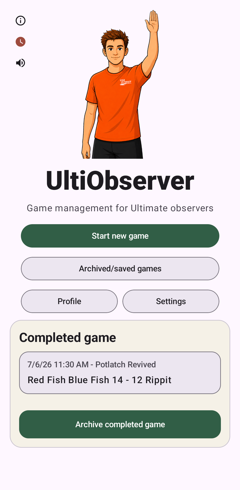

Home Screen
===========

The home screen is the starting point for UltiObserver. It provides the main actions for
starting, resuming, and finding games, along with access to your profile and settings.

The buttons in the center of the home screen open the main parts of the app:

Start new game
    This button opens the :ref:`Setup screen <setup-screen>` to start a new game. If there
    is already a current game, this action will automatically move it to the archive, so you
    cannot lose a game in progress by accidentally pressing this button.

Archived/saved games
    Opens the :ref:`Archived and Saved Games` directory. This includes completed archived
    games, active games that have (maybe accidentally) been superseded by a new game,
    and saved setup drafts of games you are planning to do in the future.

Profile
    Opens the :ref:`Profile` screen, where you can set your name and choose the avatar
    image you want displayed on the home screen.

Settings
    Opens the :ref:`Settings` screen, where you can change many aspects of how the app
    works, including the timing cues, the orientation of the :ref:`Active Game Screen`,
    connection to a paired smart watch, and more.

If there is a current game in progress (or completed, but not yet archived), it will appear
at the bottom of the home screen with a summary of the current state.
Click on the game, and it will take you to the appropriate screen for the game.
For games still being set up, it will take you to the `Setup screen <setup-screen>`.
For in-progress games, it will take you to the `Active Game Screen`.
For completed games, it will take you to the `Game Summary`.

About
-----

In the upper-left corner of the home screen, there is a small circled i icon. Click
on this to go to the **About** page.

This page shows the currently installed version of UltiObserver and provides links to:

* the Google Play page for UltiObserver to check for updates;
* this documentation;
* the privacy policy;
* the UltiObserver source code on GitHub, where you can also report bugs or request features.

Official Clock
--------------

Below the About icon on the left side of the home screen, there is a clock icon. Click on this to
go to the **Official clock** page.

This page lets you synchronize UltiObserver with a tournament's official clock being used
for start times and caps, so the time of the cap signals in the app can match
(as well as possible) the official horns.

To synchronize the clock, tap **Sync to nearest minute mark** when the tournament clock reaches
an exact minute. UltiObserver rounds its displayed time to the nearest minute. If the displayed
minute differs from the tournament clock, use **+1 min** or **-1 min** to correct it.

When UltiObserver is using an adjusted clock, the clock icon on the home screen turns red
to remind you that the app is not in sync with your phone's clock.
Tap **Reset to phone time** to go back to using your phone's own clock for the timing.

Sound Output
------------

The speaker icon below the clock on the left opens a **Sound output** dialog to change
where the app sends any timing cue sounds.
The app normally just uses your phone's default audio output, which is usually
fine, but if you have multiple Bluetooth devices connected (e.g. a watch and an ear bud),
you might want to change it.

**None** turns all sounds off. This doesn't change your setting related to
your preferred timing cue notifications. It just overrides that to mute the app when you
don't want the sounds for whatever reason.
When this option is selected, the Home icon changes to a crossed-out speaker to remind you
why you aren't getting any audio output.

**Android default** uses the default audio output according to your phone's settings.
This is the default app behavior.

**Phone speaker** uses your phone's speaker, rather than any Bluetooth or other connected
audio devices.

Below these options, you should see a list of any other audio output options currently
available on your phone. Select one of these to switch to that audio device.
If you select this, and then the audio device later disconnects, the app will revert back
to **Android default** until you change it again.

If you select **None**, you will also have an option to **Also mute vibrations?**. Setting this
to **Yes** will mute all sounds and haptic feedback from UltiObserver.

To check the audio connection, you can press **Test sound**. This plays a single beep
so you can confirm that your selected output device is working as intended.
